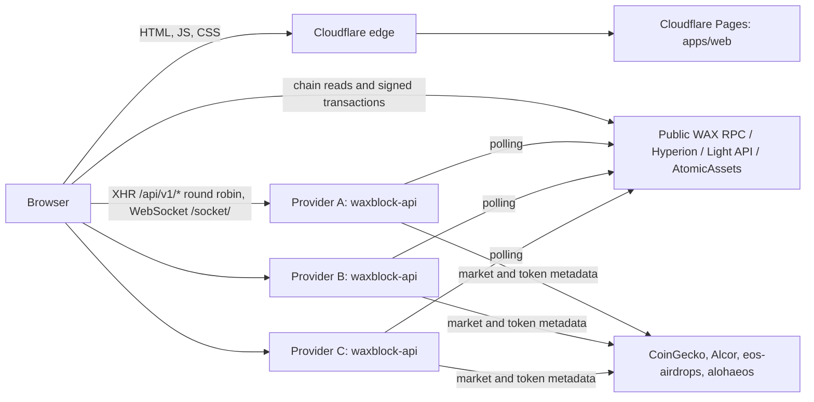

# Architecture

WaxBlock has two components. They are built from this monorepo and deployed separately.

| Component | Source | Runs as | Serves |
|---|---|---|---|
| Frontend | `apps/web` | Static site (Cloudflare Pages) | `waxblock.io`, `testnet.waxblock.io`, `local.waxblock.io` |
| API | `apps/api` | Container image `ghcr.io/worldwide-asset-exchange/waxblock-api` | One hostname per provider and network, for example `waxblock-api.waxblock.io`, `waxblock-api.eosusa.io`, `waxblock-api.eosphere.io` (mainnet) |

## Request flow

- The browser reads most chain data **directly** from public WAX endpoints. The endpoints are configured at build time in the frontend (see [CONFIGURATION.md](CONFIGURATION.md)). Users can change them in Network Settings.
- The API supplies data that is expensive to compute in a browser: network statistics, block producers and their metadata, voting proxies, token list with market data, token holders, and a live feed of blocks, transactions and top dapps over WebSocket.
- Wallet operations are signed in the user's wallet (My Cloud Wallet, Anchor). The API never signs anything and holds no keys or user data.

## API internals

- **Express** serves the REST routes under `/api/v1` (see [API.md](API.md)).
- **socket.io** serves the live feed on path `/socket/`. The frontend connects with the WebSocket transport only.
- **Cron jobs** in `apps/api/src/crons` poll the chain and third-party sources, and keep an in-memory cache:

| Job | Schedule | Source |
|---|---|---|
| Chain info | every 1 s | RPC `get_info` |
| WAX price and market data | every 5 min | CoinGecko |
| Account / global statistics | every 10 s | RPC tables |
| Block producers | every 45 min | RPC `producers`, bp.json of each producer |
| Voting proxies | every 30 min | alohaeos proxy research |
| Tokens and market data | every 30 min | Alcor markets, eos-airdrops token list, RPC |
| AtomicAssets statistics | periodic | AtomicAssets API |
| Live blocks, top dapps, TPS | every 1–2 s, **only while at least one socket client is connected** | RPC `get_block` |

- The cache is written to `CACHE_DIR/<network>` with `node-persist`. On restart the API loads it, so the data is available before the first poll completes. The cache can be deleted at any time; it is rebuilt in about 3 minutes.
- **The API load-balances its own upstreams.** Each chain and AtomicAssets endpoint variable holds a list of public providers. The API sends consecutive requests to them in turn, from a random start per process, and skips a failed provider for 30 s. Backups get traffic only when every primary failed or is cooling down. This is the same model as the browser uses for the API itself (see [CONFIGURATION.md](CONFIGURATION.md#provider-lists)).
- **No database, no message queue, no secrets.** Every instance is independent and has the same data after its first poll cycle. This is what allows the browser to send consecutive requests to different providers.

## Multi-provider model

- Three infrastructure providers each run the API for mainnet and for testnet.
- **The browser load-balances.** The frontend is built with the list of provider hostnames (`VITE_API_URL`, see [CONFIGURATION.md](CONFIGURATION.md)). `apps/web/src/app/utilities/round-robin.ts` sends consecutive API requests to the providers in turn. The starting provider is random per page load, so visitors do not all start on the first provider in the list.
- A request that fails with a network error, a timeout, `408`, `429` or `5xx` is retried on the next provider. The failed provider moves to the end of the order for 30 s. A `4xx` response is not retried.
- The WebSocket connection starts on a random provider and stays there until it closes. After 3 failed reconnection attempts it moves to the next provider. HTTP long-polling is not used.
- Provider instances do not talk to each other. A failed provider is skipped; the others keep serving.
- The frontend is deployed by the WaxBlock maintainers to Cloudflare Pages. Providers do not deploy it.
