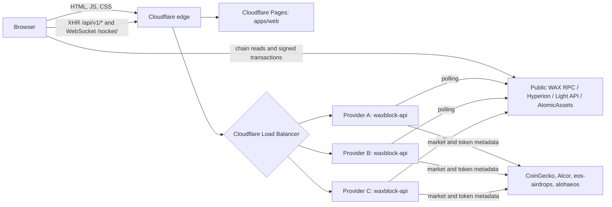

# Architecture

WaxBlock has two components. They are built from this monorepo and deployed separately.

| Component | Source | Runs as | Serves |
|---|---|---|---|
| Frontend | `apps/web` | Static site (Cloudflare Pages) | `waxblock.io`, `testnet.waxblock.io`, `local.waxblock.io` |
| API | `apps/api` | Container image `ghcr.io/worldwide-asset-exchange/waxblock-api` | `waxblock-api.waxblock.io` (mainnet), `testnet-api.waxblock.io` (testnet) |

## Request flow

- The browser reads most chain data **directly** from public WAX endpoints. The endpoints are configured at build time in the frontend (see [CONFIGURATION.md](CONFIGURATION.md)). Users can change them in Network Settings.
- The API supplies data that is expensive to compute in a browser: network statistics, block producers and their metadata, voting proxies, token list with market data, token holders, and a live feed of blocks, transactions and top dapps over WebSocket.
- Wallet operations are signed in the user's wallet (My Cloud Wallet, Anchor). The API never signs anything and holds no keys or user data.

## API internals

- **Express** serves the REST routes under `/api/v1` (see [API.md](API.md)).
- **socket.io** serves the live feed on path `/socket/`. The frontend connects with the WebSocket transport only.
- **Cron jobs** in `apps/api/src/crons` poll the chain and third-party sources, and keep an in-memory cache:

| Job | Schedule | Source |
|---|---|---|
| Chain info | every 1 s | RPC `get_info` |
| WAX price and market data | every 5 min | CoinGecko |
| Account / global statistics | every 10 s | RPC tables |
| Block producers | every 45 min | RPC `producers`, bp.json of each producer |
| Voting proxies | every 30 min | alohaeos proxy research |
| Tokens and market data | every 30 min | Alcor markets, eos-airdrops token list, RPC |
| AtomicAssets statistics | periodic | AtomicAssets API |
| Live blocks, top dapps, TPS | every 1–2 s, **only while at least one socket client is connected** | RPC `get_block` |

- The cache is written to `CACHE_DIR/<network>` with `node-persist`. On restart the API loads it, so the data is available before the first poll completes. The cache can be deleted at any time; it is rebuilt in about 3 minutes.
- **No database, no message queue, no secrets.** Every instance is independent and has the same data after its first poll cycle. This is what allows several providers to serve the same hostname behind a load balancer.

## Multi-provider model

- Three infrastructure providers each run the API for mainnet and for testnet.
- Cloudflare Load Balancing sends each request to a healthy provider. The health signal is `GET /api/v1/health` (see [DEPLOYMENT.md](DEPLOYMENT.md#health)).
- Provider instances do not talk to each other. A provider failure removes that provider from the pool; the others keep serving.
- WebSocket connections stay on the provider that accepted them until they close. HTTP long-polling is not used, so the load balancer needs no session affinity for correctness (session affinity is still enabled as a safety net).
- The frontend is deployed by the WaxBlock maintainers to Cloudflare Pages. Providers do not deploy it.
